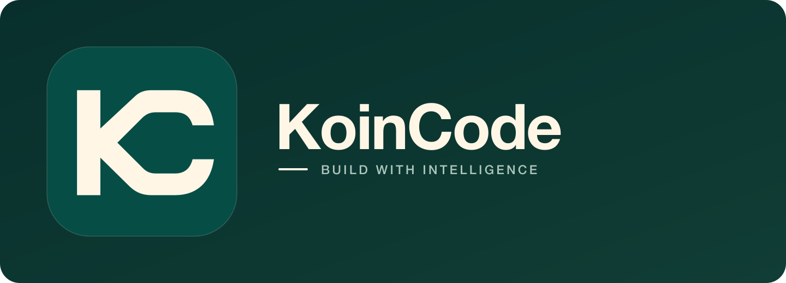
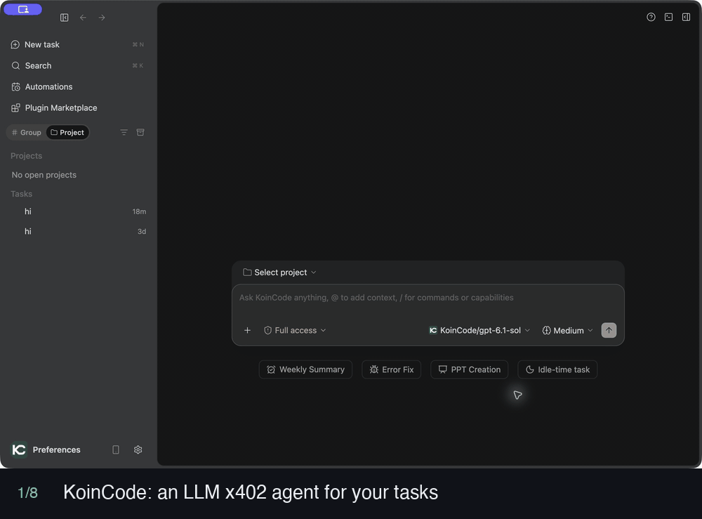
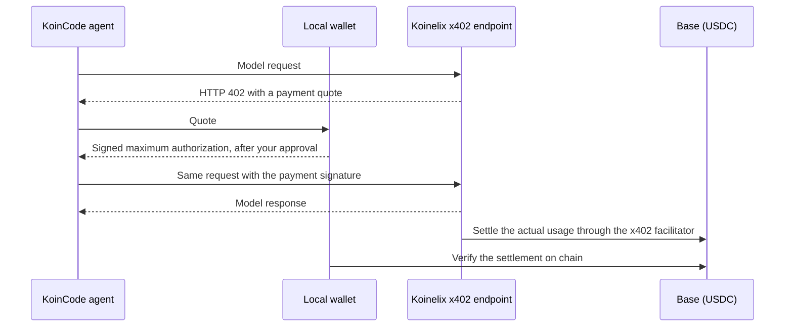
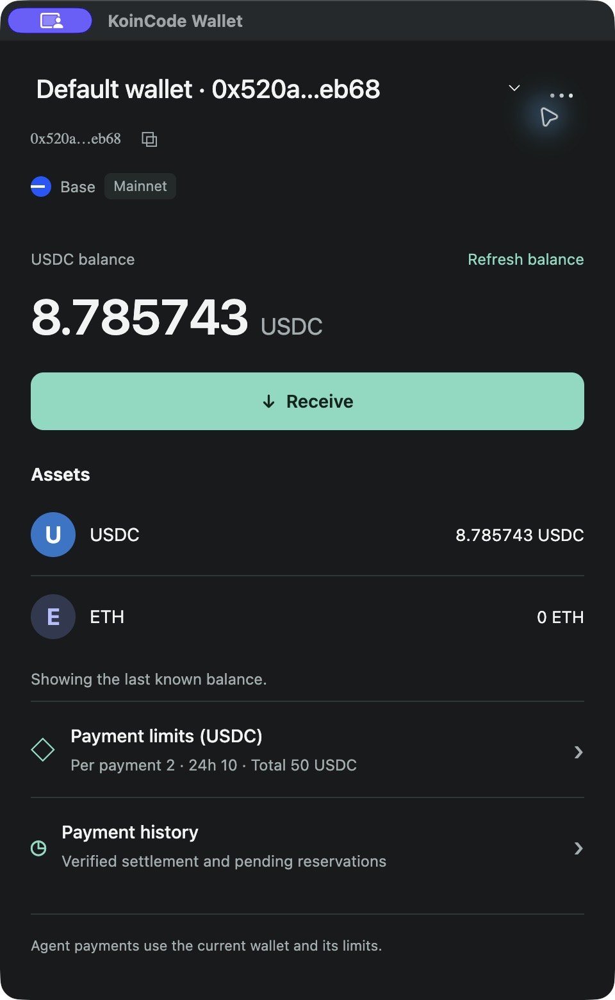
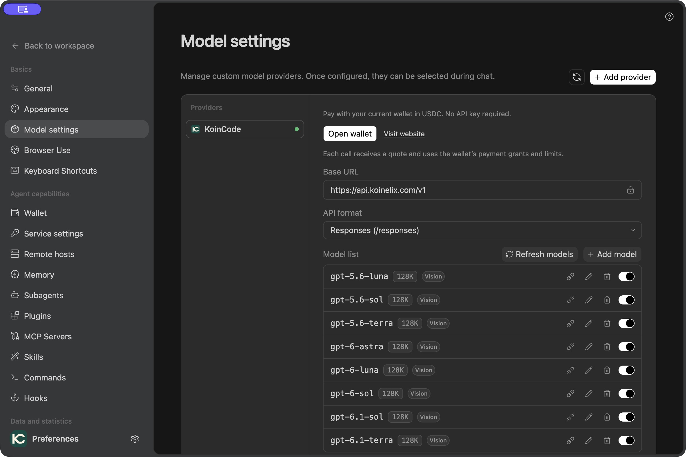
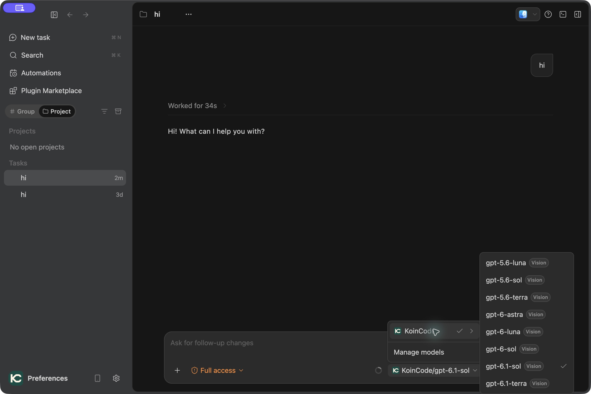
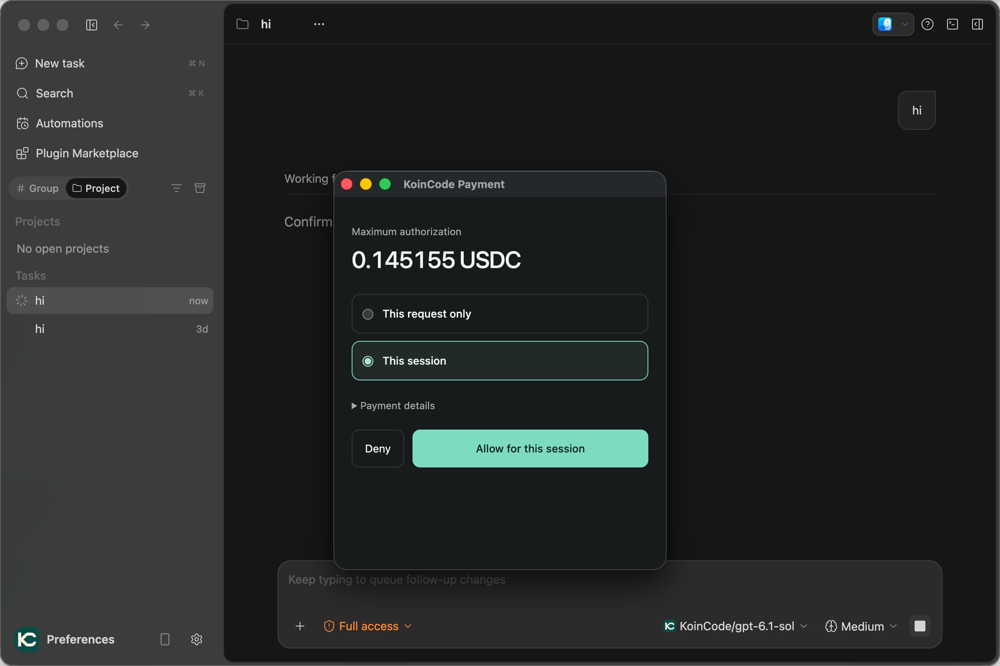
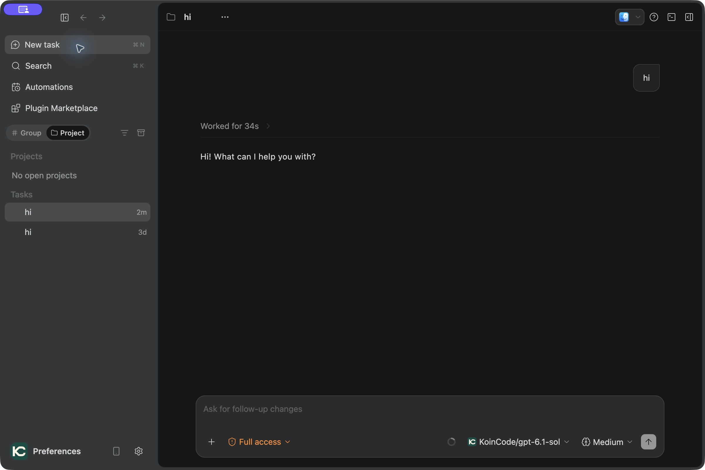
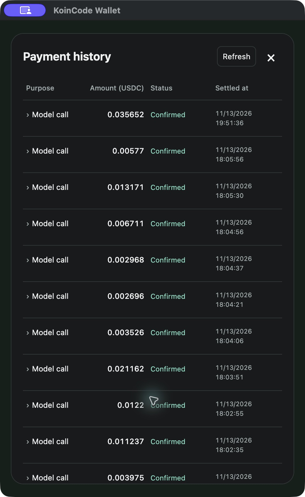
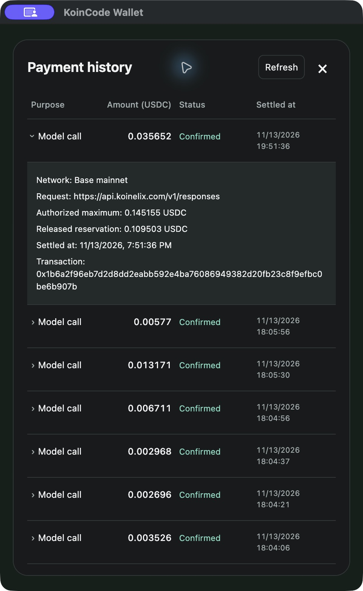

<p align="center">
  
</p>
<p align="center"><strong>KoinCode</strong>: An open-source LLM x402 agent.</p>
<p align="center">
  <a href="https://github.com/Koinelix/koincode/releases"></a>
  <a href="LICENSE"></a>
</p>
<p align="center"><a href="https://koinelix.com/">Website</a> | English | <a href="README.zh-CN.md">中文</a></p>

KoinCode is an open-source desktop AI agent that pays for its own model calls with [x402](https://www.x402.org/). Each model request is quoted over HTTP 402 and paid in USDC from a wallet on your machine, so there is no LLM API key to configure. Around that, it is a full agent: chat, work on local code, and complete tasks with tools, MCP, and skills.

**Current source version: 4.1.3.** Check the [Releases page](https://github.com/Koinelix/koincode/releases) for published installer versions and platforms.



The walkthrough is assembled from app screenshots. Models, balances and amounts are examples; current availability and prices come from the platform catalog and each request's quote.

## What LLM x402 means here

HTTP has long reserved status code 402, "Payment Required". x402 puts it to use: a server answers a request with a price, the client attaches a signed payment, and the server completes the request. KoinCode applies this to LLM calls, with [Koinelix](https://koinelix.com) as the model service.

- **No API key, no balance to top up.** USDC stays in your own wallet until a request is settled.
- **Pay per request.** Every model request carries its own quote and its own payment.
- **Authorize a maximum, pay for actual usage.** The wallet signs a ceiling for the request; the settled charge is the usage actually billed, and the rest of the reservation is released.
- **You approve payments.** Approve a single request or the current session, always within the wallet's per-payment, 24-hour and total limits.
- **Every charge is checkable.** Payment history shows the settled amount, the authorized maximum and the on-chain transaction reference.

### How a paid model request works



1. The agent sends a model request to the Koinelix x402 endpoint.
2. The endpoint replies with HTTP 402 and a quote: asset, network, recipient and maximum amount.
3. The local wallet checks the quote against your limits and authorizations. If approval is needed, the **KoinCode Payment** window asks you.
4. The wallet signs an authorization for that maximum, and the agent repeats the request with the signature.
5. The model runs and the reply streams into the task.
6. The actual usage is settled in USDC on Base through the x402 facilitator. The wallet needs USDC only, not ETH for gas.
7. The wallet verifies the settlement on chain and records the charge and the released reservation in **Payment history**.

x402 payments in KoinCode currently work with the Koinelix endpoint only: Base mainnet in installed packages, Base Sepolia for source development.

## Before you start

- **Real funds.** Installed packages use Base mainnet, and model calls spend real USDC. Fund the wallet only with what you plan to spend.
- **Unsigned macOS package.** macOS packages currently have no Developer ID signature or notarization, so macOS may block opening them. Download only from this project's Releases page and verify the checksum.
- **Keys stay on your machine.** Wallet secrets are protected by the operating system's secure storage. Never post keys, recovery material, API keys or authorization callback URLs in issues, screenshots or logs.

## Download

Installers are published on the [Releases page](https://github.com/Koinelix/koincode/releases/latest). The source repository itself contains no binary installers.

| Platform | Package |
| --- | --- |
| macOS (Apple silicon, M series, arm64) | `.dmg` |
| Windows x64 | `.exe` installer |

The macOS package is for Macs with an M-series chip (M1, M2, M3, M4 and so on) only and does not support Intel-based Macs. No installer is provided for Intel Macs yet; you can try building from source (`package.sh x64`, not verified by us).

Each package comes with a same-named `.sha256` checksum file; verifying it after download is recommended. Using an installer does not require Node.js, pnpm or build commands. If your platform has no package, build from source.

## Quick start: run your first LLM x402 task

### 1. Launch the app and fund the wallet

Install the package for your platform and launch KoinCode. If **Welcome to KoinCode** appears, choose **Skip for now** to enter the workspace.

Open **Preferences → Wallet** and create or import a wallet. Check the network, use **Receive** to find the receiving address, and fund it with USDC on that network. **Payment limits (USDC)** shows the per-payment, 24-hour and total limits.



### 2. Discover models

Open **Preferences → Model settings** and select **KoinCode**. Click **Refresh models**, then enable the models you want. This built-in provider connects to Koinelix and does not require an API key or a new custom provider.



### 3. Create a task and select a model

Return to the workspace and choose **New task**. Open the model selector in the composer, expand **KoinCode** and choose an enabled model. For local coding tasks, select the project directory and an appropriate permission level first.



### 4. Send the request and review payment authorization

Describe your goal in the task composer and send the message. When payment authorization is needed, the **KoinCode Payment** window shows the **Maximum authorization**. Choose **This request only** or **This session**, and expand **Payment details** to review the request's payment information before approving. Session authorization covers matching requests within its scope and the wallet limits without asking again.

The amount shown here is an authorization ceiling, not the final charge. In this example the maximum is **0.145155 USDC**.



### 5. Read the reply and continue working

The model's response appears in the task; the screenshot uses **KoinCode/gpt-6.1-sol**. Continue with follow-up questions or a project task. Each further model request is quoted and paid the same way, under the applicable authorization and limits.



### 6. Review actual charges and settlement details

Open the wallet and choose **Payment history** to see amounts, statuses and settlement times. The status distinguishes confirmed charges from pending reservations.



Expand a **Model call** row to inspect its network, request URL, authorized maximum, released reservation and transaction reference. The example below shows **0.035652 USDC** confirmed against an authorized maximum of **0.145155 USDC**, with **0.109503 USDC** of the reservation released. The figures illustrate the difference between the ceiling and the settled charge; they are not a fixed model price.



## More features

- Chat with an AI in a desktop window and work on local code after choosing a project directory.
- Plugins, MCP, skills, subagents and workflows.
- Other model connections: OAuth accounts and your own API keys, with in-app subscription usage for Codex, Antigravity and Cline accounts. See [Other model connections](docs/model-providers.md).
- Import visible conversation history from Claude Code, Codex or Antigravity and continue chatting in KoinCode.
- Configure SSH hosts in Preferences and use `/remote-host` with the built-in `remote-host-operations` skill to work with remote files and commands.
- A built-in browser for viewing and operating web pages.
- Computer Use operates local applications through screenshots and real mouse and keyboard input on macOS and Windows (experimental). See [Computer Use](docs/computer-use.md).
- Workspaces, sessions and settings are stored on your machine.

## Build from source

Three scripts under `apps/desktop` cover the whole flow: **Build → Run → Package**. Run all commands from the repository root.

### Requirements

| Platform | What you need |
| --- | --- |
| macOS | Node.js and pnpm (versions in `apps/desktop/mise.toml`), Xcode Command Line Tools (`xcode-select --install`) |
| Windows x64 | Node.js 24.x on `PATH`; pnpm 10.x is optional. If pnpm is missing, the scripts enable the declared version through corepack (the first run needs network access). |

The first build runs `pnpm install --frozen-lockfile` automatically, so you do not need to install dependencies by hand.

### macOS

```bash
# 1. Build
./apps/desktop/build.sh

# 2. Run (starts the desktop app in development mode; press Ctrl+C to exit)
./apps/desktop/run.sh
# Connect to mainnet
./apps/desktop/run.sh mainnet

# 3. Package (produces a .dmg, for the host architecture by default)
./apps/desktop/package.sh
```

Useful options:

```bash
./apps/desktop/build.sh --release    # build, then package; same as build.sh followed by package.sh
./apps/desktop/package.sh arm64      # pick the architecture: arm64 or x64
```

#### Testnet and mainnet

Choose the payment network when starting development. The network and Koinelix endpoint are paired in `apps/desktop/config/network.json` and are not read from environment variables:

```bash
./apps/desktop/run.sh            # Base Sepolia; local platform at http://127.0.0.1:8080/v1 (must already be running)
./apps/desktop/run.sh mainnet    # Base mainnet; https://api.koinelix.com/v1; spends real USDC
```

The default testnet mode expects a Koinelix platform on your own machine, which is not part of this repository. Without one, the built-in x402 models are unavailable in that mode; use `mainnet` to reach the hosted service, where model calls spend real USDC. Other model connections work in either mode.

- The network is fixed at build time. Stop and restart with the desired argument to change it.
- Wallet data is separate: `~/.koincode/wallet/m4-testnet` for testnet and `~/.koincode/wallet/mainnet` for mainnet. First-time mainnet payment requires registering the payment source through the existing system authentication flow (Touch ID on macOS).
- Refresh the Koinelix model list after switching.
- Packaging (`package.sh`) always uses mainnet.

### Windows

```powershell
# 1. Build
.\apps\desktop\build.cmd

# 2. Run (starts the desktop app in development mode; press Ctrl+C to exit)
.\apps\desktop\run.cmd

# 3. Package (produces an .exe installer; x64 only)
.\apps\desktop\package.cmd
```

Useful options:

```powershell
.\apps\desktop\build.cmd --release   # build, then package
.\apps\desktop\run.cmd mainnet       # run on mainnet (testnet is the default)
```

You can also double-click the scripts inside `apps/desktop`.

### Notes on running

- Build before the first Run; Run tells you to run Build first if dependencies are missing.
- Run isolates development data in `~/.koincode/dev`. Installed builds default to `~/.koincode`; wallet files use a separate `wallet/` subtree, with secrets protected by the operating system.
- Run needs local port 5174 to be free; stop any previously started instance if it is in use.
- Keep the terminal open while it runs and press `Ctrl+C` to exit.

### Where installers are written

- Windows: `releases/windows/<version>/`, producing an `.exe` installer.
- macOS: `releases/macos/<version>/`, producing a `.dmg` plus a `.sha256` checksum file (the build also leaves a `.zip` for local use only; it is not published).

These directories are local build output, ignored by `.gitignore` and never committed. Installers for distribution are uploaded to [GitHub Releases](https://github.com/Koinelix/koincode/releases).

## Feedback and contributing

If you run into a problem or have a suggestion, please open an [issue](https://github.com/Koinelix/koincode/issues). Pull requests are welcome.

This repository is published as snapshots of our development tree, and the test suites are not included yet. A change we accept is applied to the development tree and appears here in a later snapshot.

## Attribution and third-party licenses

Project provenance and acknowledgements are recorded in [ATTRIBUTION.md](ATTRIBUTION.md). Third-party components and their licenses are listed in [apps/desktop/THIRD-PARTY-NOTICES.md](apps/desktop/THIRD-PARTY-NOTICES.md).

## License

This project is released under the [Apache License 2.0](LICENSE).
