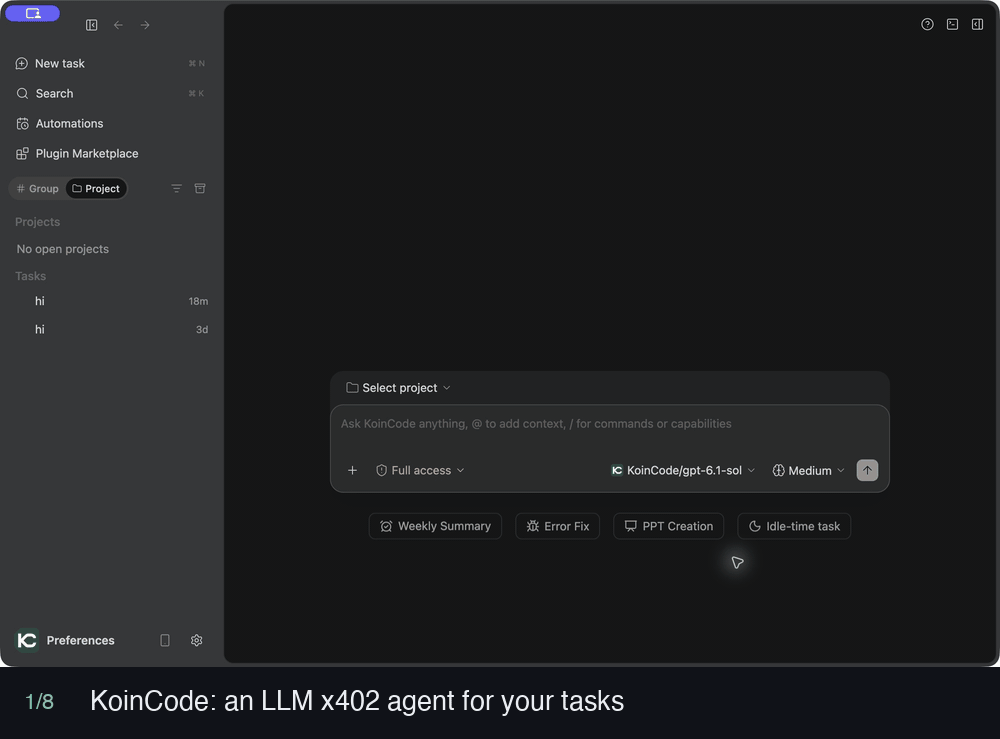
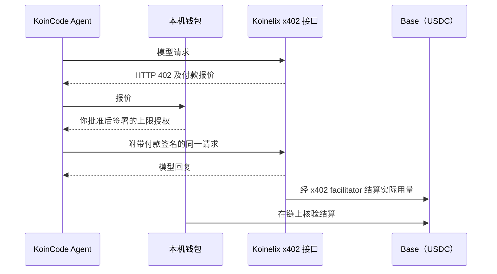
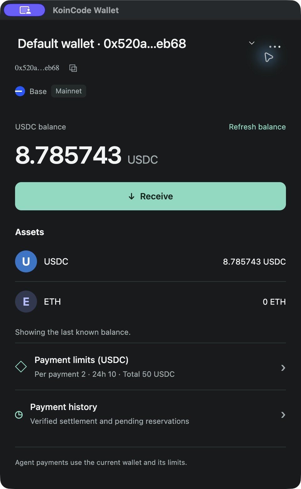
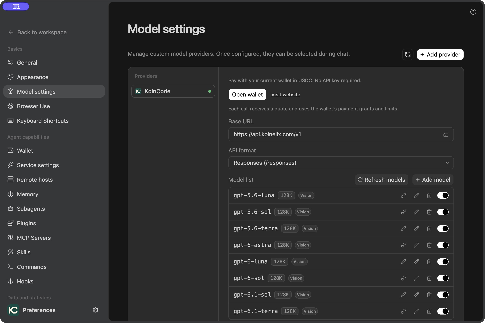
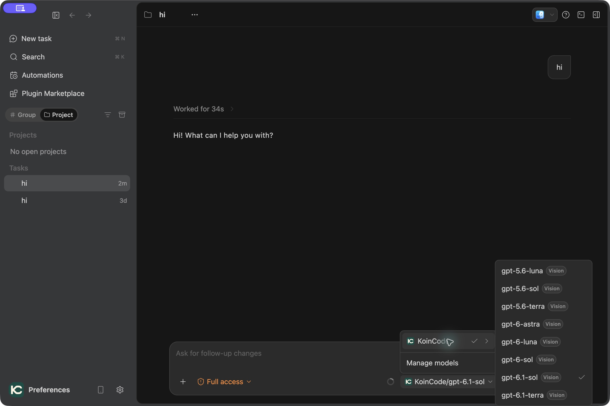
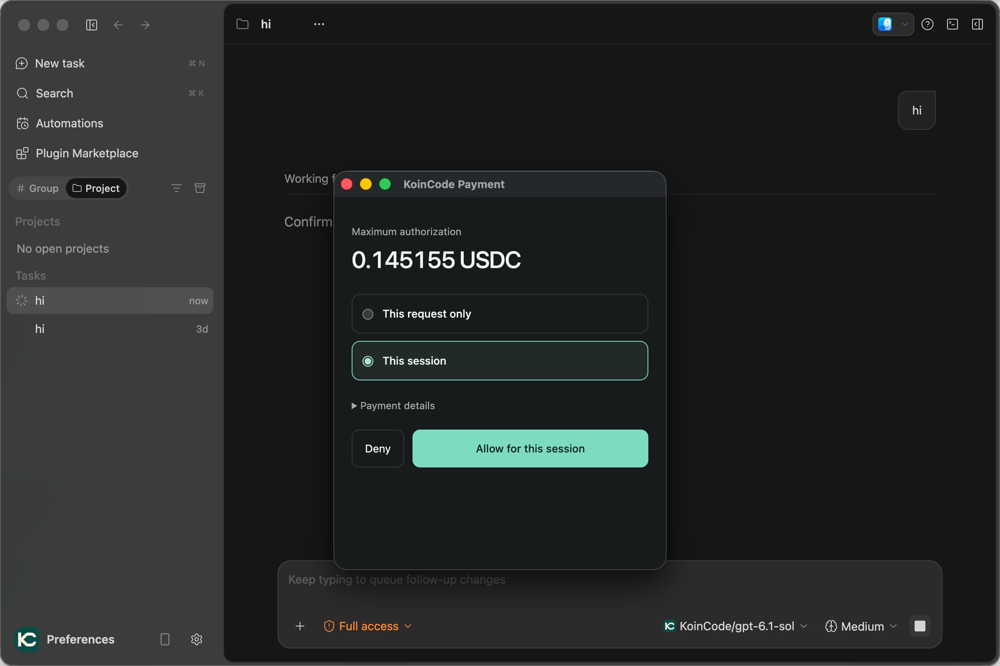
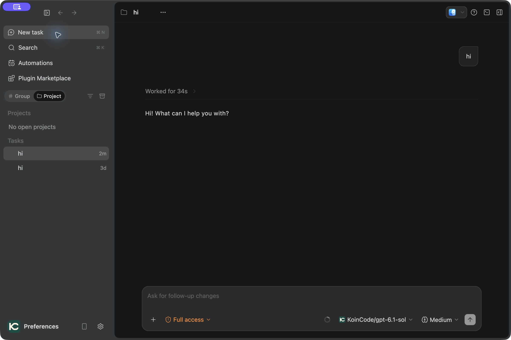
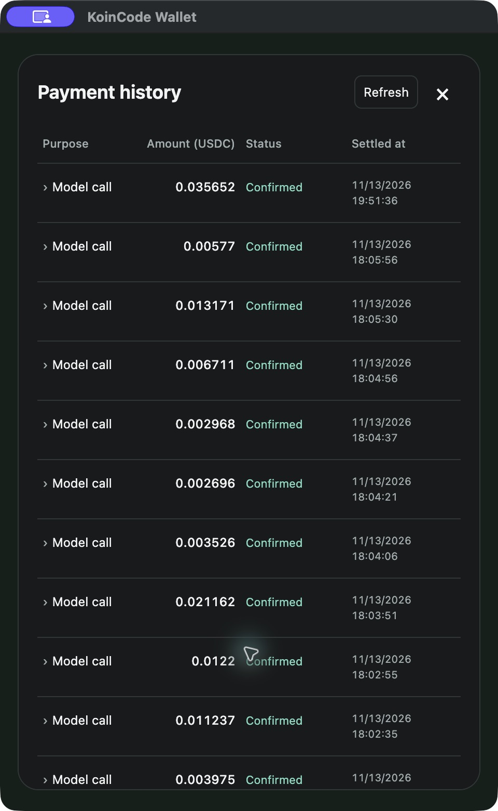
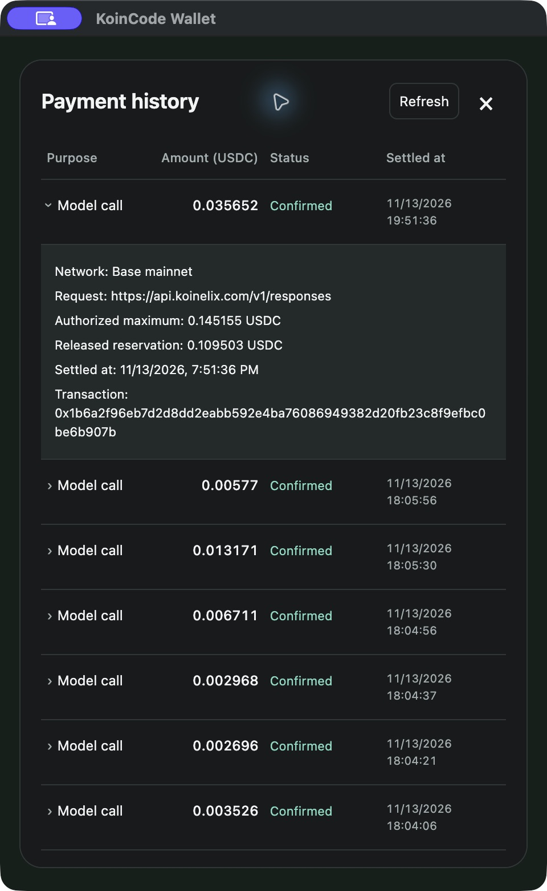

<p align="center">
  
</p>
<p align="center"><strong>KoinCode</strong>：开源的 LLM x402 智能体</p>
<p align="center">
  <a href="https://github.com/Koinelix/koincode/releases"></a>
  <a href="LICENSE"></a>
</p>
<p align="center"><a href="https://koinelix.com/">官网</a> | <a href="README.md">English</a> | 中文</p>

KoinCode 是一款开源桌面 AI Agent，通过 [x402](https://www.x402.org/) 为自己的模型调用付款。每次模型请求都经 HTTP 402 报价，并由你本机的钱包以 USDC 支付，因此无需配置 LLM API key。在此之上，它是一个完整的 Agent：对话、处理本地代码，并结合工具、MCP 和技能完成任务。

**当前源码版本：4.1.3。** 已发布安装包的版本和平台请以 [Releases 页面](https://github.com/Koinelix/koincode/releases) 为准。



演示由应用截图组合而成。图中的模型、余额和金额均为示例，当前可用模型与价格以平台目录及每次请求的报价为准。

## 这里的 LLM x402 指什么

HTTP 很早就保留了 402 状态码“Payment Required”。x402 把它用了起来：服务端用价格回应请求，客户端附上签名的付款，服务端再完成请求。KoinCode 把这套流程用于 LLM 调用，模型服务由 [Koinelix](https://koinelix.com) 提供。

- **无需 API key，也无需充值余额。** 请求结算之前，USDC 一直留在你自己的钱包里。
- **按请求付款。** 每次模型请求都有各自的报价和付款。
- **授权上限，按实际用量付费。** 钱包为请求签署一个上限；结算金额是实际计费的用量，其余预占会被释放。
- **付款由你批准。** 可授权单次请求或当前会话，并始终受钱包的单笔、24 小时和总限额约束。
- **每笔费用都可核对。** 付款历史展示结算金额、授权上限和链上交易引用。

### 一次付费模型请求的过程



1. Agent 向 Koinelix x402 接口发送模型请求。
2. 接口返回 HTTP 402 和报价：资产、网络、收款方和最高金额。
3. 本机钱包按你的限额和已有授权核对报价。需要批准时，**KoinCode Payment** 窗口会向你询问。
4. 钱包签署该上限的授权，Agent 附带签名重新发送请求。
5. 模型运行，回复流式显示在任务中。
6. 实际用量经 x402 facilitator 在 Base 上以 USDC 结算。钱包只需要 USDC，不需要 ETH 支付 gas。
7. 钱包在链上核验结算，并在 **Payment history** 中记录费用和释放的预占。

KoinCode 的 x402 付款目前只对接 Koinelix 接口：安装包使用 Base 主网，源码开发使用 Base Sepolia。

## 开始之前

- **真实资金。** 安装包使用 Base 主网，模型调用会支付真实 USDC。钱包里只转入你打算花费的金额。
- **macOS 安装包未签名。** macOS 安装包目前未使用 Developer ID 签名或公证，系统可能阻止打开。请只从本项目 Releases 页面下载，并核对校验值。
- **密钥留在本机。** 钱包秘密由操作系统的安全存储保护。不要在 Issue、截图或日志中公开密钥、恢复资料、API key 或授权回调地址。

## 下载

安装包发布在 [Releases 页面](https://github.com/Koinelix/koincode/releases/latest)，源码仓库本身不包含任何二进制安装包。

| 平台 | 安装包 |
| --- | --- |
| macOS（Apple 芯片 M 系列，arm64） | `.dmg` |
| Windows x64 | `.exe` 安装程序 |

macOS 安装包仅适用于搭载 M 系列芯片（M1、M2、M3、M4 等）的 Mac，不支持 Intel 芯片的 Mac；Intel Mac 暂未提供安装包，可尝试从源码构建（`package.sh x64`，我们尚未验证）。

每个安装包旁附有同名 `.sha256` 校验文件，下载后建议核对。使用安装包无需安装 Node.js、pnpm，也无需执行编译命令。没有对应平台安装包时，可从源码构建。

## 快速开始：运行第一个 LLM x402 任务

### 1. 启动应用并为钱包充值

安装对应平台的安装包并启动 KoinCode。如果出现 **Welcome to KoinCode**，选择 **Skip for now** 进入工作区。

打开 **Preferences → Wallet**，创建或导入钱包。核对当前网络，通过 **Receive** 查看收款地址，并转入该网络的 USDC。**Payment limits (USDC)** 展示单笔、24 小时与总付款限额。



### 2. 获取模型

进入 **Preferences → Model settings**，选择 **KoinCode**。点击 **Refresh models**，启用需要的模型。这个内置供应商连接 Koinelix，无需填写 API key，也无需新增自定义供应商。



### 3. 创建任务并选择模型

返回工作区，选择 **New task**。打开输入框中的模型选择菜单，展开 **KoinCode**，选择已启用的模型。处理本地代码时，先选择项目目录和适当的权限范围。



### 4. 发送请求并核对付款授权

在任务输入框中描述目标并发送消息。需要付款授权时，**KoinCode Payment** 窗口会显示 **Maximum authorization**。选择 **This request only**（仅本次请求）或 **This session**（当前会话），并展开 **Payment details** 核对本次请求的付款信息后再授权。会话授权覆盖其范围和钱包限额内符合条件的请求，不再逐次询问。

这里的金额是授权上限，并非最终费用。图中示例上限为 **0.145155 USDC**。



### 5. 查看模型回复并继续工作

模型回复会显示在任务中；截图使用的模型为 **KoinCode/gpt-6.1-sol**。随后可继续追问或处理项目任务。之后的每次模型请求都以同样方式报价和付款，并受适用的授权和限额约束。



### 6. 查看实际费用和结算详情

打开钱包，选择 **Payment history**，查看金额、状态和结算时间。状态用于区分已确认费用与待处理的预占。



展开一条 **Model call**，查看网络、请求地址、授权上限、释放的预占和交易引用。下图记录显示已确认金额 **0.035652 USDC**，授权上限 **0.145155 USDC**，释放预占 **0.109503 USDC**。这些数值用于说明授权上限与实际结算费用的区别，并非固定模型价格。



## 更多功能

- 在桌面窗口中与 AI 对话，选择项目目录后处理本地代码。
- 支持插件、MCP、技能、子代理与工作流。
- 其他模型接入方式：OAuth 账号与自带 API key，并可在应用内查看 Codex、Antigravity 和 Cline 账号的订阅套餐用量。见[其他模型接入方式](docs/model-providers.zh-CN.md)。
- 导入 Claude Code、Codex 或 Antigravity 的可见对话历史，并在 KoinCode 中继续对话。
- 在偏好设置中配置 SSH 主机，通过 `/remote-host` 与内置 `remote-host-operations` 技能操作远程文件和命令。
- 内置浏览器，可用于查看和操作网页。
- Computer Use 可通过截图和真实键鼠操作本机应用，支持 macOS 与 Windows（实验性）。见 [Computer Use](docs/computer-use.zh-CN.md)。
- 工作区、会话与设置保存在本机。

## 从源码构建

使用 `apps/desktop` 下的三个脚本完成：**编译（Build）→ 运行（Run）→ 打包（Package）**。以下命令均从仓库根目录执行。

### 环境要求

| 平台 | 需要准备 |
| --- | --- |
| macOS | Node.js 与 pnpm（版本见 `apps/desktop/mise.toml`）、Xcode Command Line Tools（`xcode-select --install`） |
| Windows x64 | Node.js 24.x，加入 `PATH`；pnpm 10.x 可选。缺少 pnpm 时，脚本通过 corepack 启用项目声明的版本，首次需要联网下载。 |

首次编译会自动执行 `pnpm install --frozen-lockfile` 安装依赖，无需手动安装。

### macOS

```bash
# 1. 编译
./apps/desktop/build.sh

# 2. 运行（开发模式启动桌面端，退出按 Ctrl+C）
./apps/desktop/run.sh
#  连接主网
./apps/desktop/run.sh mainnet

# 3. 打包（生成 .dmg，默认与本机架构一致）
./apps/desktop/package.sh
```

常用选项：

```bash
./apps/desktop/build.sh --release    # 编译后继续打包，等价于依次执行 build.sh 和 package.sh
./apps/desktop/package.sh arm64      # 指定架构，可选 arm64 或 x64
```

#### 测试网与正式网

开发运行时用参数选择付款网络，网络与 Koinelix 模型地址成对定义在 `apps/desktop/config/network.json`，不读环境变量：

```bash
./apps/desktop/run.sh            # 测试网（默认）：Base Sepolia，模型地址 http://127.0.0.1:8080/v1（需本机平台已启动）
./apps/desktop/run.sh mainnet    # 正式网：Base 主网，模型地址 https://api.koinelix.com/v1，模型调用会支付真实 USDC
```

默认的测试网模式需要你本机运行 Koinelix 平台，而该平台不包含在本仓库中。没有本机平台时，这个模式下内置的 x402 模型不可用；使用 `mainnet` 可连接线上服务，模型调用会支付真实 USDC。其他模型接入方式在两种模式下都可用。

- 网络在构建时写入，切换需停止后带参数重新运行；运行中不能切换。
- 两网钱包数据分开：测试网 `~/.koincode/wallet/m4-testnet`，正式网 `~/.koincode/wallet/mainnet`。首次在正式网付款需通过现有的系统认证流程登记付款来源（macOS 上为 Touch ID）。
- 切换后在设置中刷新一次 Koinelix 模型列表。
- 打包（`package.sh`）固定使用正式网，不受运行参数影响。

### Windows

```powershell
# 1. 编译
.\apps\desktop\build.cmd

# 2. 运行（开发模式启动桌面端，退出按 Ctrl+C）
.\apps\desktop\run.cmd

# 3. 打包（生成 .exe 安装包，仅支持 x64）
.\apps\desktop\package.cmd
```

常用选项：

```powershell
.\apps\desktop\build.cmd --release   # 编译后继续打包
.\apps\desktop\run.cmd mainnet       # 以正式网运行（默认测试网），说明见上方“测试网与正式网”
```

也可以在 `apps/desktop` 目录中双击对应脚本。

### 运行说明

- 第一次使用请先编译，再运行；缺少依赖时 Run 会提示先执行 Build。
- Run 使用 `~/.koincode/dev` 隔离开发数据。正式安装版默认使用 `~/.koincode`；钱包文件使用独立的 `wallet/` 子目录，秘密继续由系统安全存储保护。
- Run 需要本机 5174 端口空闲；端口被占用时请先关闭之前启动的实例。
- 运行时保持终端打开，退出时按 `Ctrl+C`。

### 安装包输出位置

- Windows：`releases/windows/<版本号>/`，生成 `.exe` 安装包。
- macOS：`releases/macos/<版本号>/`，生成 `.dmg` 并附 `.sha256` 校验文件（构建时还会附带一个 `.zip`，仅供本地使用，不对外发布）。

这些目录是本地构建产物，已被 `.gitignore` 忽略，不会提交到仓库；对外发布的安装包统一上传到 [GitHub Releases](https://github.com/Koinelix/koincode/releases)。

## 反馈与贡献

使用中遇到问题或有改进建议，欢迎在 [Issues](https://github.com/Koinelix/koincode/issues) 中反馈，也欢迎提交 Pull Request。

本仓库以开发源码树快照的形式发布，目前尚未包含测试套件。被采纳的改动会先合入开发源码树，再出现在之后的快照中。

## 来源与第三方许可

项目来源与致谢见 [ATTRIBUTION.md](ATTRIBUTION.md)，第三方组件及其许可证见 [apps/desktop/THIRD-PARTY-NOTICES.md](apps/desktop/THIRD-PARTY-NOTICES.md)。

## 许可证

本项目依照 [Apache License 2.0](LICENSE) 开源。
